# Sentinel/Terraform Assignment.

## Introduction
This assignment demonstrates creating Policy-as-code using Terraform and Sentinal. The intent is to enforce sovereignty for Ireland and IaC supply chain security requirements, and demonstrate policy enforcement in non-compliant and compliant situations. 

## Areas
  - Digital sovereignty Policies: 
     - restrict infrastructure to defined geo. regions.
     - enfore data residency reguirements for resrouces storing sensitive infomation. 
  - IaC supply chain security : 
     - Restrict Terraform providers to appoved sources.
     - Enfore appoved provider versions. 
     - Require (trusted?) Terraform module sources and specific versions. 
  - Infrastructure security policies:
     - Approved EC2 instance types
     - Encrypted EBS storage.
     - Implement IMDSv2.
     - Approiate network security considerations. 
     - Restrictions on inbound SSH access. 

## Report
As part of this assignment a technical report describing final limitations and recommendations.
See [Report](/documentation/PolicyAsCodeFramework.docx)

## AI Prompts
I used Google Gemini to generate policies once I had created the Terraform scripts and applied them in AWS. 

See [AI_Prompts](/documentation/AI_Prompts.txt)


## Terraform & Test environment.
This environment has a single EC2 instance, RDS SQL database (1 node) and S3 storage (intended for backups/data copy within the environment). 
(overkill perhaps, but I wanted to learn some Terraform )

This [tutorial](https://aws.plainenglish.io/building-aws-vpc-and-ec2-infrastructure-with-terraform-a-hands-on-devops-tutorial-4955eac76f4f) gave me the initial script setup (main.tf really).  Following the assignment and other prompts I split the script as follows :  

To give a scenario I could test and experiment with sentinel I modified the environment as follows : 
 - remove webserver components, just use a basic EC2 instance and add a mysql client.
 - Add single node RDS SQL database. From learning on an earlier assignment this required additional subnet and RDS subnet (AWS requirement)
 - Network changes to only allow port 22 from my laptop to the EC2 instance. From there use the mysql client.
 - Added s3 storage bucket.  This will be a backup location. To access from the EC2 instance it required an IAM role and policy.
- Split the main.tf into component files, ensured variables were used throughout and listed once on the variables.tf file. terraform.tfvars acts as an override. 

````
|--terraform
   |
   |-main.tf       AWS resource definition
   |-network.tf    Network components
   |-providers.tf  Provider versions.
   |-versions.tf   Terraform versions
   |-outputs.tf    Outputs to display after deployment
   |-variables.tf  Variable definition with defaults.
   |-terraform.tfvars actual variable values / overrides.
````
I stood up the environment using Terraform apply and validated the relevant aspects (all components in correct region, access between EC2 and RDS and S3 .. again , overkill)

The Terraform plan binary in included in this repo 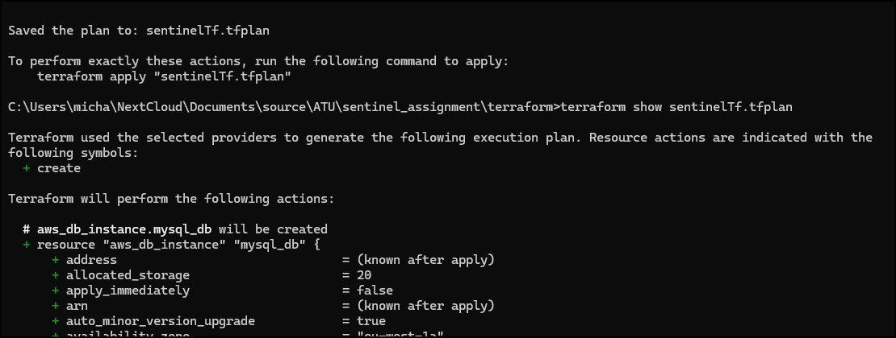 
The binary file is located in terraform\sentinelTf.tfplan.

## Sentinel Policies and Terrform UI.
- I created a HashiCorp Cloud and HCP Terraform accounts , downloaded the sentinel binary file.
- Followed assignment/Gemini on structuring the sentinel files, test folders and content. 
- Created an organisation, project "sentinel-test" and workspace "Work_Sentinel_test" on Terraform hcl and linked this github repository to it.
- In the organisation, I needed to create "individually managed policies" and a policy set to cover them. The Terraform free tier has restictions:
  - 1 policy set. (for free-tier this cannot be created by linking to GitHub and reading the sentinel.hcl / .sentinel files)
  - 1 policy only may be set "Hard Manadatory" or "Soft Mandatory", the rest needed to be "Advisory".
- Created a run (plan only) which generated mock/test data to download. Extracted files and placed this in the terraform folder. [zipfile](/terraform/run-JvxYqKbp68aBDmy4-sentinel-mocks.tar.gz)

For a production environment, the Policies should be maintained in a seperate GitHub repository from Terraform code. This would allow policy changes to be written in the .sentinel files and reflected automatically in the Terraform Cloud policy set when that is linked to a repo. 
Also best practices around security & seperation of duty access to the policies should be restricted. 
[Terraform Best Practices](https://developer.hashicorp.com/terraform/cloud-docs/users-teams-organizations/permissions/organization)

- Initially Google Gemini had given me the policy definition suitable for instance-type, sovereignty and allowed-providers. 
  - I was able to test/validate the policy pass and fail scenarios. 
  - I was able to substitute instance types, regions that were not allowed in the .sentinel files and these failed/flagged as expected when executed via CLI 

- Terraform Cloud free-tier did not allow a policy set to be created directly from a GH repo, instead I had to copy the .sentinel code into "Individually managed policies" and create a single policy set.

|Policies|Policy Set|Note|
|----|----|----|
|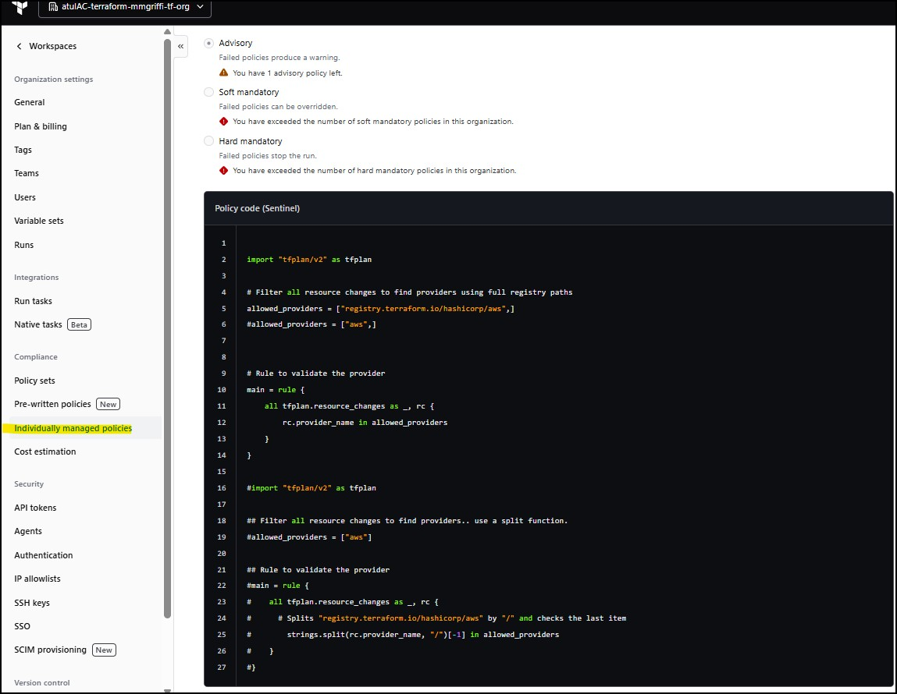 .sentinel code can be copied inline, enforcement is limited to 1 hard-mandatory for free-tier|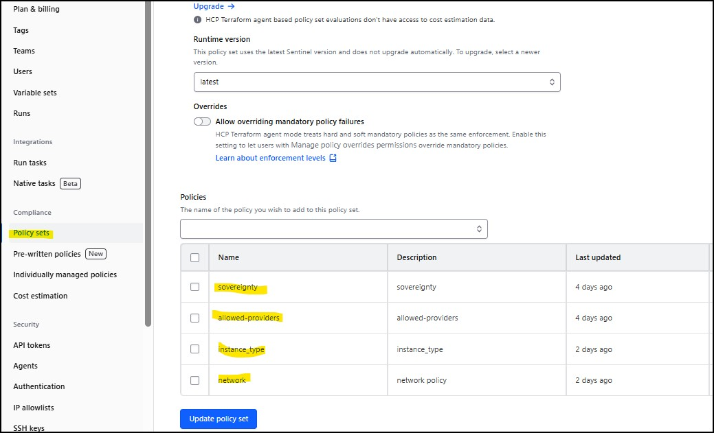 Policy set with 4 individual policies||


## Create test runs on Terraform UI

https://app.terraform.io/app/atuIAC-terraform-mmgriffi-tf-org/workspaces

The test runs generated a plan and policy 

|Policy Name|Details|Passing Image|Failing Image|Notes
|----|----|----|----|----|
|Sovergnity|limited to a single region "allowed_regions = ["eu-west-1"]"   |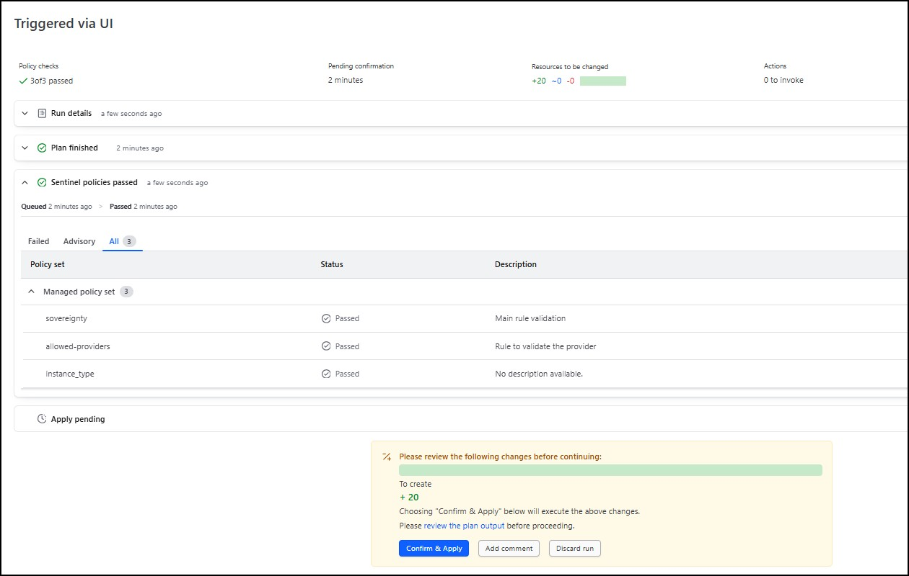|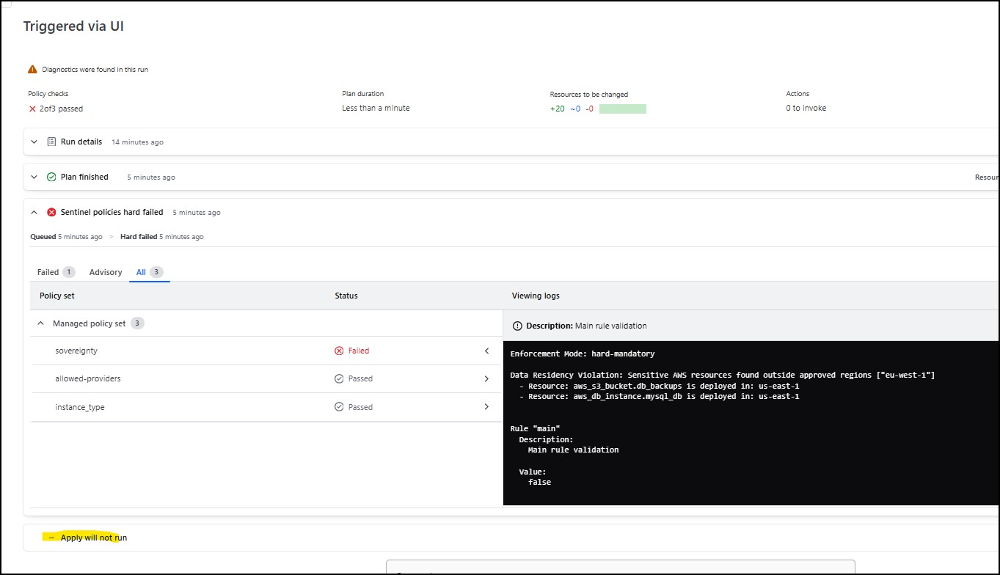|To test switch terrafrom.tfvars to aws_region = "us-east-1", commit changes to GitHub and re-trigger Terraform UI run for new plan|
|Instance-type|uses array of instance types````"allowed_types = ["t3.micro", "t3.small","t2.micro"]"````and ensure ebs is encrypted and IMDSv2 is enabled||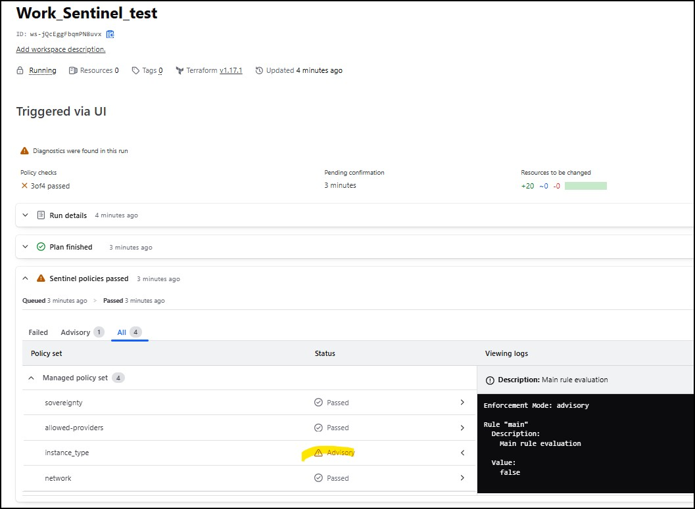|To test, updated main.tf with IMDSV2 , encryption settings and re-ran plan|
|Network|check if port 22 is open to 0.0.0.0/0 (if so flag unbound acccess), ensure only public subnets route to internet, ensure db security group ingress only has port 3306  |||
|allowed-providers|limit providers using ````allowed_providers = ["registry.terraform.io/hashicorp/aws",]````|||

Note: Terraform Policy definitions only allow 1 hard enforcement so I needed to configure others as advisory.
- 
see [logs](/documentation/run-evumM51u7MjMAAKA-policy-check-log.txt)

## Use Sentinel CLI to test policies with Mock Terraform data.

Terraform UI will create a mock data package based on the most recent terraform scripts in the GitHub repo. Once extracted and placed in the terraform folder of this repo I could test the policies locally. The [sentinel.hcl](sentinel.hcl) file contains the list of policies to execute against and an enforcement level.  If I wanted to trigger policy failures a change to the variables.tf or terraform.tfvars could be committed and a new mock data set generated. 

|Policy Name | Passing Image | Failing Image | Notes|
|----|----|----|----|
|InstanceType|Mock data regenerated with IMSDv2 and encryption set 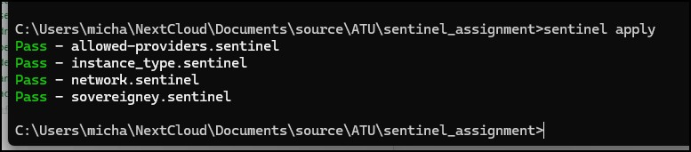| IMSDv2 and ebs encryption not initially set 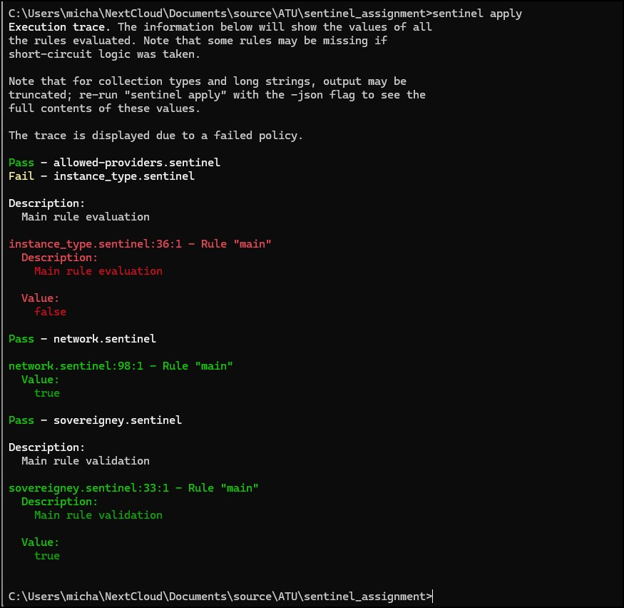||
||||

## Use Sentinel CLI to test policies with Mock data snippets.
Sentinel CLI has a "test" mode that will evaluate a policy with test case data. This does not use the sentinel.hcl file. Individual policies can be checked, or all policies in the current folder. 
The structure I arrived at is 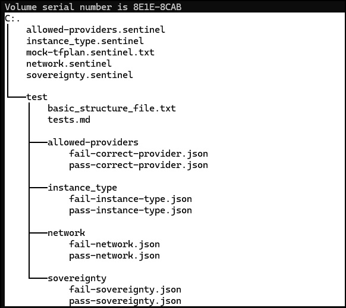

The passing  and failing test cases can be updated without needing to regenerate the Terraform mock data.  

|Policy Name|Testcase content|Results|Command|
|----|----|----|----|
|sovereignty|This is the content of an failing test case with us-east-1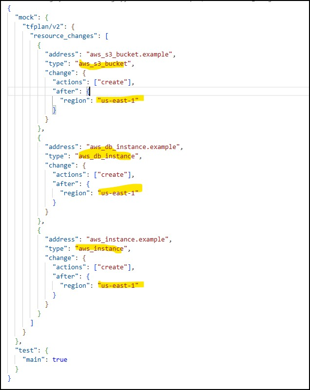|This shows the pass/fail test cases.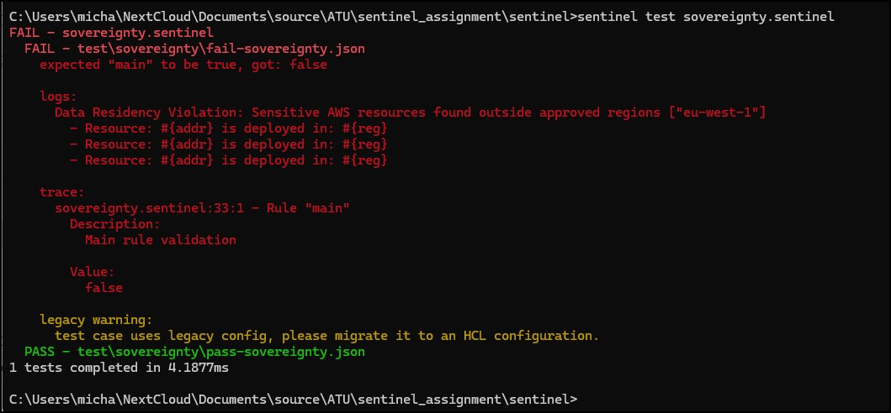| ````sentinel test sovereignty.sentinel````|
|network|This is the network test case with unbound SSH access and incorrect port access to db subnet 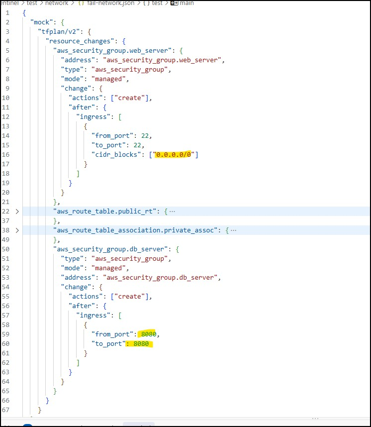|Failing test case details 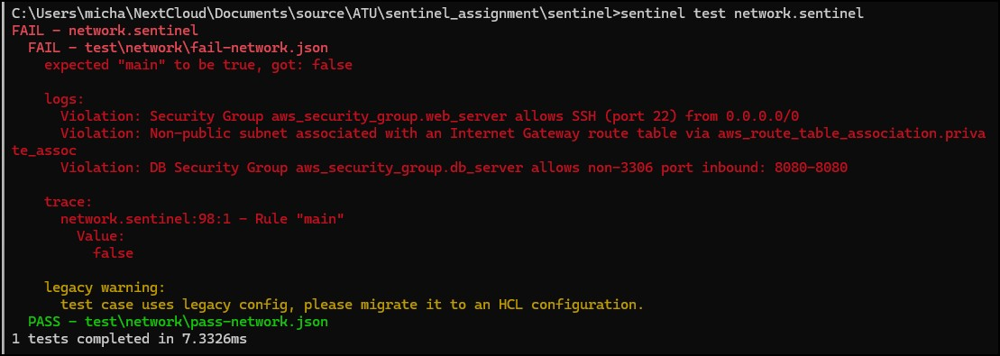|A real IP address (e.g 86.45.159.23) would pass|


## Decision justification in the README.md 
**Comments on your evaluation of the effectiveness of Policy as Code for digital sovereignty**

Relying soley on Terraform /Policy as code to enfore digital sovereignty/residency still allowed a user with the relevant console / AWS CLI access change or add resources outside of Terrafrom. Applying SCP (Service Control Policies) to an account with the correct restrictions sets a limit on what the user can do with AWS Console, CLI or Terraform can do.

|Org/Account|Console Effect|Note|
|----|----|----|
|euwest-operator is an IAM user in euwest-user account. That has a "Deny-Non-EU-West-1-Regions" policy 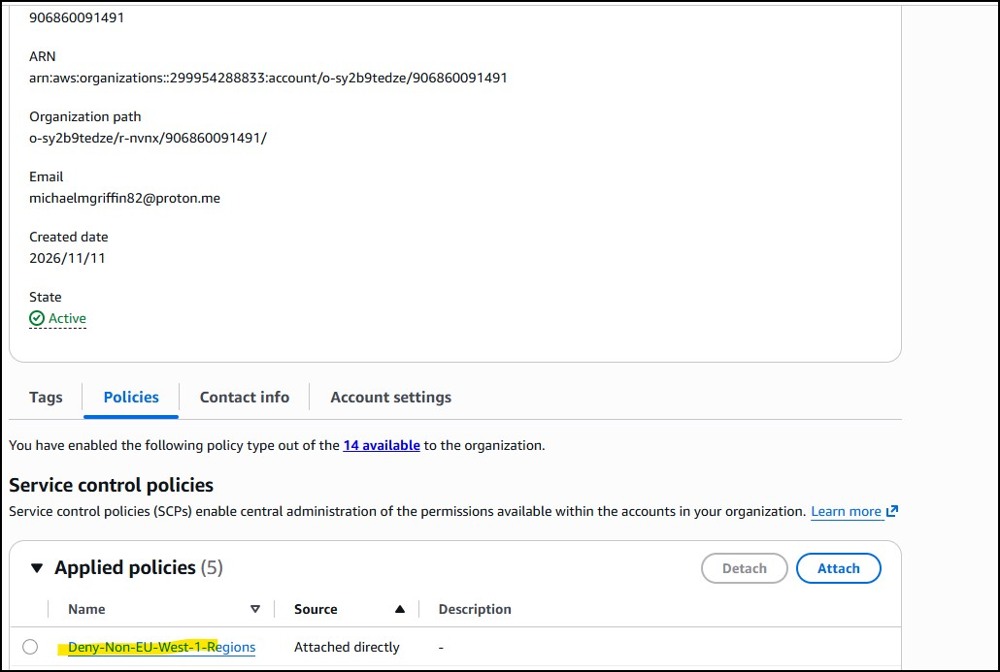|Attempt to create a resource while outside eu-west-1 is denied 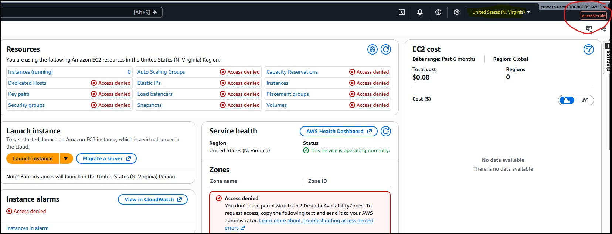||
|the same user has access within eu-west-1|Can create resources 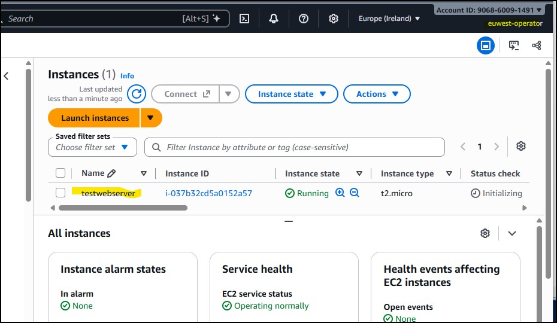|Confirmed euwest user was able to create + delete an EC2 instance. |

**The limitations of region-based data residency controls**
A combination of Terraform/sentinel controls will ensure the data and resources are hosted in the desired region. That does not prevent 

For tighter control of where the data can be used, AWS Customer Managed Keys (CMK) in the Key Management service is region specific. You can only use it to encrypt/decrypt data inside the region it was created for and can't be used in any other region. The controls applied earlier (EBS storage encryption/ IMDSv2 ) will use this key. 

(CMKS incur a cost , so I didn't try to implement any)
see https://docs.aws.amazon.com/kms/latest/developerguide/overview.html

In practice the terraform scripts created so far can be expanded to :
(1) Create a CMK. 
(2) apply it to the resources such as the s3 bucket, rds database or EC2 instance volumes. 

Then the sentinel policies could be updated to enforce CMK encryption on the resources. 

**The importance of supply chain integrity.** 

In a controlled environment ,  controlling where Terraform gets its code (providers and modules) and which versions it runs is essential for supply-chain security. If the user pulls an unverified provider or community module, that third-party code could compromise security or not work as intended. 

- This example in terraform locks sources and terraform versions

```` Configure Terraform and AWS Provider
terraform {
  required_providers {
    aws = {
      source  = "hashicorp/aws"
      version = "~> 6.69"
    }
  }
  required_version = ">= 1.16.3"
}
````
- And the policy encforces this strictly to only use a hashicorp/terraform registry
````
import "tfplan/v2" as tfplan
# Filter all resource changes to find providers using full registry paths
allowed_providers = ["registry.terraform.io/hashicorp/aws",]
#allowed_providers = ["aws",]

# Rule to validate the provider
main = rule {
    all tfplan.resource_changes as _, rc {
        rc.provider_name in allowed_providers
    }
}
````

- For **Terraform Modules** : Terraform modules are reusable collection of terraform files. Using unvetted modules (for example pulled randomly from a github source) can be an obvious security risk. There are official modules availble from Terraform [link](https://registry.terraform.io/browse/modules) which are safe to use. 

In addition you can use your own GitHub repositories or maintain Terraform modules on your Terraform Organisation. 
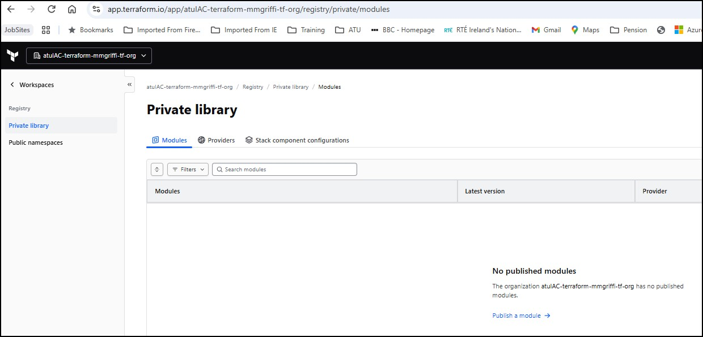

The module is called in the Terraform script to execute the step (create network, bucket etc.)

A policy can be implemented to enforce only approved modules. 
````
# Define approved module prefixes
approved_prefixes = [
    "app.terraform.io/atuIAC-terraform-mmgriffi-tf-org/",
    "./", # Allow local sub-modules inside the same repository
]
````
- For **Providers** : Sentinel policies should enforce the use of providers from trusted sources, such as the official Terraform Registry and providers published by approved vendors (e.g, HashiCorp and AWS).

## The limitations of Sentinel and Terraform plan-time enforcement ##

When a Terraform plan runs, certain items are marked as "known after apply", so sentinel is unable to validate rules that depend on a final value. This may be an issue with IP addresses, to address this Terraform can run addition checks after the address is known that flag if it falls outside the allowed range  (e.g regular expression checks for patterns of IP address )  

According to terraform ( https://developer.hashicorp.com/terraform/policy/compare ) , sentinel executed after Terraform init, by which time any modules or 3rd party package are already downloaded.  

## The challenges of maintaining policies as cloud environments evolve ##

Maintaining policies involve static lists, references to specific images or instance types creates significant overhead as these change as older versions are retired, or patches are released that change the ID. Cloud providers release new services, retire older ones and update the configurations referenced by Terraform over time. This has impacts both for the Terraform scripts as well as the policies. Both will need to be maintained on an ongoing basis.  

**Examples :** 
 - In this simple assignment I've used 1 specific Ubuntu AMI ID in terraform, and a range of instance types in the sentinel policy. This presents a challenge as over time the AMI ID may be deprecated, patched with a new ID and the instance type ("t2.micro") will eventaully be retired. 
 - Another example : Originally for the sovereignty policy I had listed **only** the resources I was creating and evaluating them for the region "eu-west-1" compliance [script](/sentinel/sovereignty.sentinel) . This turned out to be a poor design, In the 2nd version, I check the region of **ANY** resources which means it does not need to be updated with new items [script](/sentinel/sovereignty_2.sentinel). This was a learning. 

 **Mitigations** 
  1. We could configure a GH Action workflow with a self-hosted runner to automatically executed the sentinel test CLI commands once a .sentinel file is added or modified. 
  2. When adding a new policy, we should regenerate mock data from Terraform based on the current TF scripts. 
  3. To keep developers notified on changes we should configure AWS EventBridge along with Slack notifications to alert if a particular image or instance type is retired/removed. 
  4. **Drift Detection**: It is important to detect and flag any manual changes to the AWS environment via the console. You can schedule Terraform plan runs against the live AWS environment for this purpose (it does not make changes). This will also flag if modified/new policies would render the existing production infrastructure non-compliant with the policy.

# Links
https://medium.com/@bicutler/using-hashicorp-sentinel-to-implement-policy-as-code-within-your-terraform-provisioning-workflow-c89aac0ecc8

https://mattias.engineer/blog/2024/hashicorp-sentinel-with-terraform/

https://developer.hashicorp.com/terraform/language/style

https://discuss.hashicorp.com/t/tool-to-convert-cloudformation-to-terraform/46704

https://aws.plainenglish.io/building-aws-vpc-and-ec2-infrastructure-with-terraform-a-hands-on-devops-tutorial-4955eac76f4f
